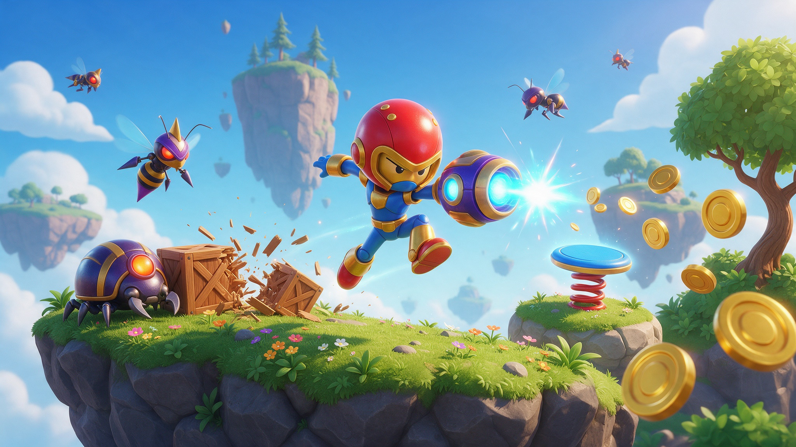
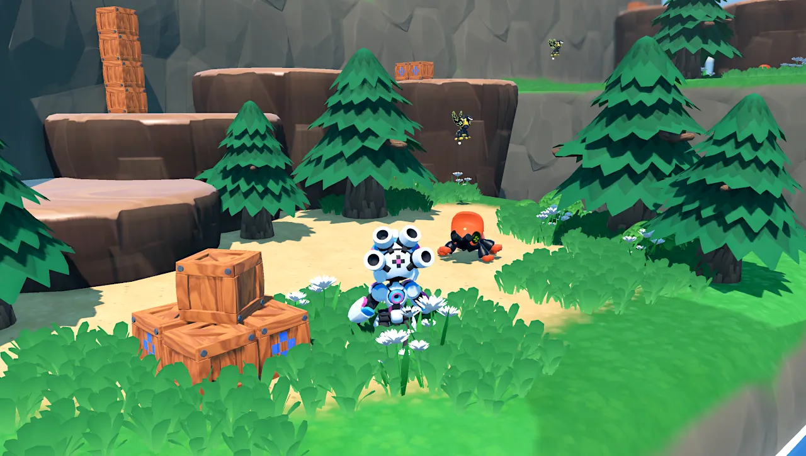
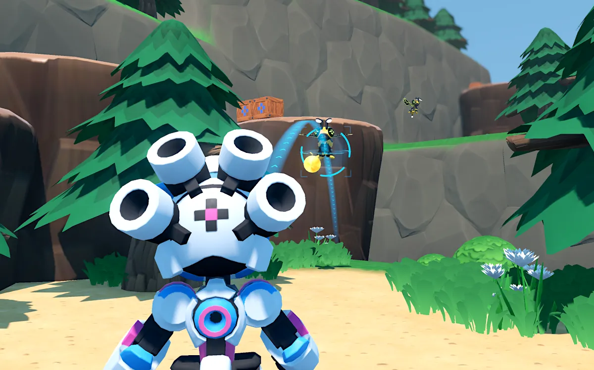

# RoboBlast: Third-Person Shooter Demo

A polished third-person controller: run, jump, melee, aim, shoot and lob grenades, with robot enemies to use it on.

> **Made by [GDQuest](https://www.gdquest.com/), adapted for Summer Engine.**
> This is GDQuest's open-source RoboBlast demo
> ([original repository](https://github.com/gdquest-demos/godot-4-3d-third-person-controller)),
> MIT-licensed code and CC-By 4.0 art. If you ship a game built on it, credit GDQuest. See `LICENSE`.

## What's inside

- A complete third-person character: run, jump, melee, over-the-shoulder aiming, projectile shooting and grenades with a trajectory preview.
- A frame-rate independent camera with tuned mouse and gamepad sensitivity.
- Two enemy types: flying wasp bots that fire bullets and beetle bots that attack on the ground, with animated skins and death effects.
- Breakable crates, jump pads, and coins that fly to the player.
- A dressed environment with trees, grass scattering and flower patches.
- A plug-and-play `Player` scene you can copy into your own project.

## Get started

1. [Download the ZIP](https://github.com/SummerEngine/template-3d-third-person-controller/archive/refs/heads/master.zip) or clone the repo:
   `git clone https://github.com/SummerEngine/template-3d-third-person-controller.git`
2. Open the folder in [Summer Engine](https://www.summerengine.com/download).
3. Press Play.

Summer's AI agent can extend it for you. Try asking:

- "Add a double jump and a dash on Shift."
- "Add a health bar for the player and make beetle bots deal damage on contact."
- "Build a second level with moving platforms and a boss at the end."

## Controls

- <kbd>W</kbd><kbd>A</kbd><kbd>S</kbd><kbd>D</kbd> or <kbd>left stick</kbd> to move.
- <kbd>mouse</kbd> or <kbd>right stick</kbd> to move the camera.
- <kbd>Space</kbd> or <kbd>Xbox A</kbd> to jump.
- <kbd>Left mouse</kbd> or <kbd>Xbox B</kbd> to shoot.
- <kbd>Right mouse</kbd> or <kbd>Xbox RT</kbd> to aim.
- <kbd>Tab</kbd> or <kbd>Xbox X</kbd> to switch between bullets and grenades.

## FAQ

### How do I use the player character in my game?

Copy these folders into the root of your project:

- `player`: the main player assets and scenes.
- `shared`: shaders used by the player asset.

The player scene needs these `Input Map` actions:

- `move_left`, `move_right`, `move_up`, `move_down`: move the character relative to the camera.
- `camera_right`, `camera_left`, `camera_up`, `camera_down`: rotate the camera around the character.
- `jump`, `attack`, `aim`, `swap_weapons`: action buttons.

The player scene works on its own and does not need another camera. Change the player UI through the `Control` node inside the player scene.

## License

All code is MIT-licensed, and assets are CC-By 4.0 [GDQuest](https://www.gdquest.com/). See [LICENSE](LICENSE).
